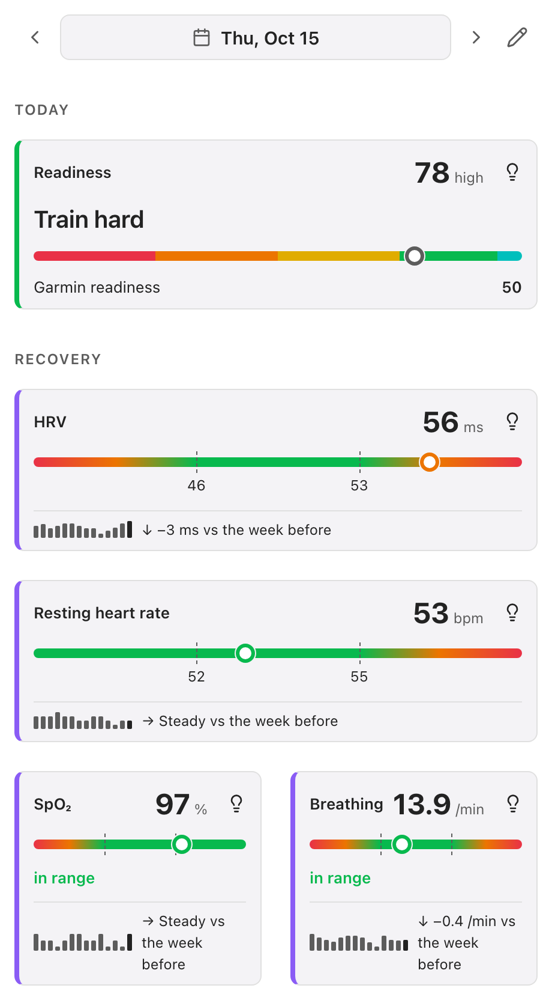
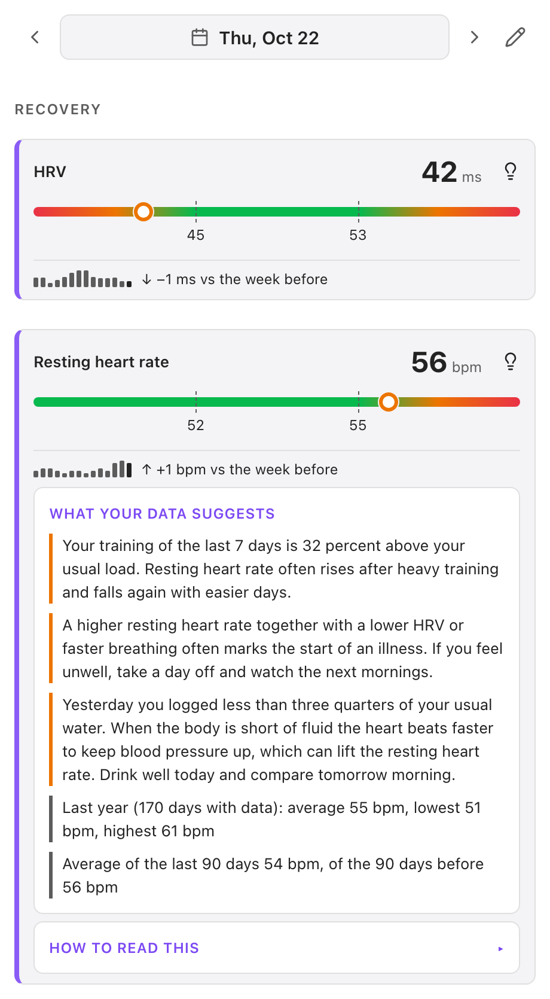
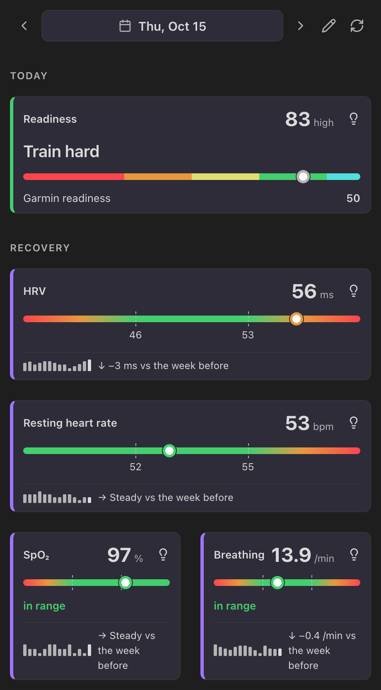
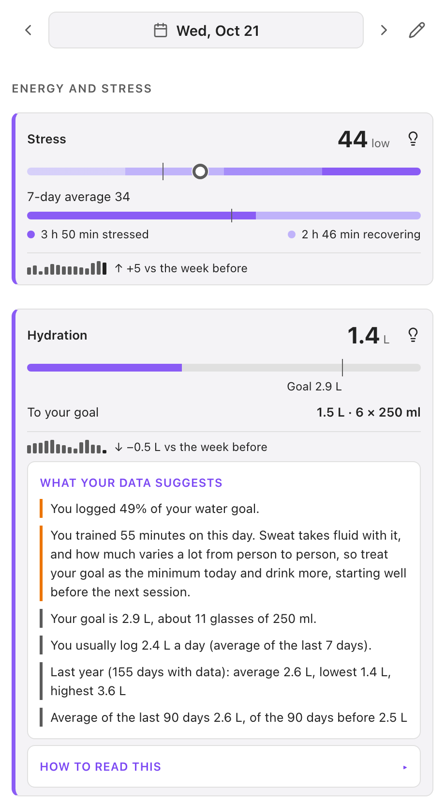
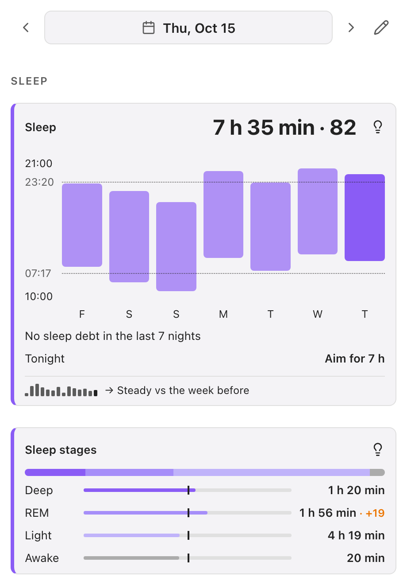
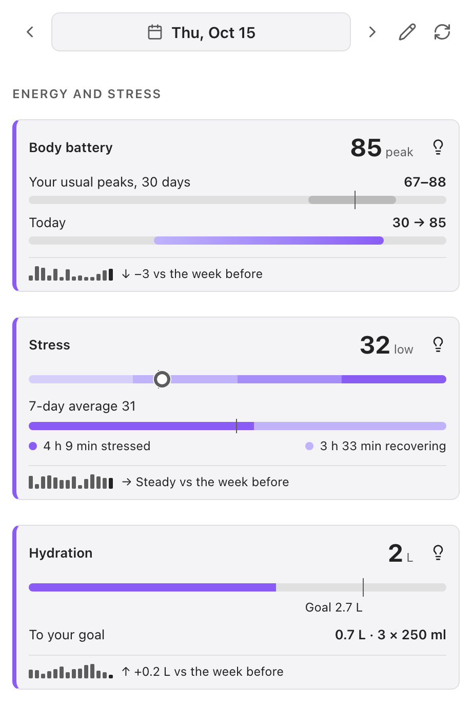
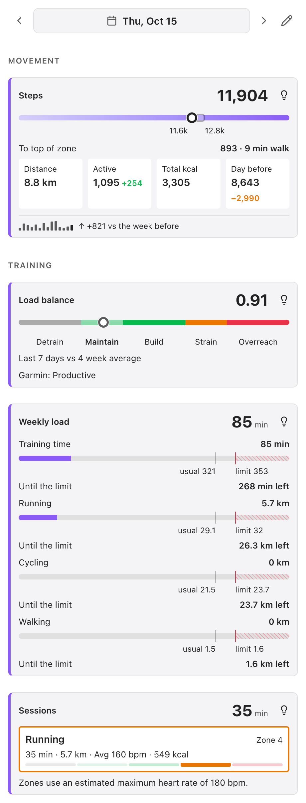

[English](README.md) · [Deutsch](README.de.md) · **中文** · [日本語](README.ja.md) · [Español](README.es.md) · [Français](README.fr.md)

# Garmin Health Sync

**你每日笔记的好帮手。** Garmin Health Sync 把 Garmin 手表上最重要的数据带进你的 Obsidian 每日笔记，并可按需展示你与自己日常水平相比的状态。它不是 Garmin Connect 的复制品：目标是帮助你为这一天做出正确的决定。

**两种使用方式**

- **保持简单。** 登录并开启你想要的指标。它们会作为可用 Dataview 查询的属性写入每日笔记，评估由你自己完成。
- **在笔记旁添加可视化。** 在设置中开启**侧边面板**，即可看到关于准备度、恢复、睡眠、能量、活动和训练的卡片，并与你自己的日常范围对比。每张卡片上的灯泡会告诉你今天的数据提示了什么。[每张卡片显示什么、如何计算](docs/panel-cards.md)。

<p>



</p>

> **支持桌面端和移动端**（Windows、macOS、Linux、iOS、Android）。本插件使用 Garmin Connect 的内部 API；Garmin 没有提供官方第三方 API。你使用 Garmin 邮箱和密码登录（如启用两步验证，还需输入验证码）。如果 Garmin 阻止此次尝试，可使用备用的浏览器登录方式。

## 文档

- [设置](docs/settings.md) — 每一项设置
- [指标](docs/metrics.md) — 写入你笔记的每个属性
- [侧边面板卡片](docs/panel-cards.md) — 每张卡片显示什么、帮助做哪项日常决定、如何计算
- [灯泡下的解读](docs/panel-insights.md) — 每条提示何时出现及其依据
- [历史笔记与回填](docs/history.md) — 历史如何保存与构建
- [故障排除](docs/troubleshooting.md) — 登录、缺失的指标、面板、笔记和回填
- [更新日志](CHANGELOG.md) — 每个版本的变化

## 功能特性

- **启动时自动同步** —— 检查最近 7 天并补充缺失的健康数据
- **等待笔记模式** — 可让自动同步等待其他工具（Templater、Calendar、外部同步）创建每日笔记，而不是自己创建
- **手动同步** —— 通过命令面板同步任意已打开的 Daily Note
- **回填** —— 批量同步一段日期范围（例如最近 3 个月）
- **30+ 项指标** —— 步数、睡眠评分、HRV、压力、身体电量、SpO2、体重等
- **运动追踪** —— 每次锻炼以易读的摘要形式呈现
- **运动地点** —— 通过逆地理编码获取首个 GPS 活动的地名
- **智能检测** —— 自动识别你的 Daily Notes 路径和格式（来自 Periodic Notes 或内置 Daily Notes 插件）
- **子目录支持** —— 在嵌套文件夹中查找已有的 Daily Notes（例如 `Journal/2024-07/`）；文件名格式包含 `/` 时会按日期创建子文件夹（例如 `YYYY/YYYY-MM-DD` → `Journal/2026/2026-08-04.md`）
- **语言自动检测** —— UI 语言根据你的 Obsidian 语言设置自动适配（EN、DE、ZH、JA、ES、FR）
- **可选的结构化数据** —— 机器可读的 `trainings` 字段，用于高级 Dataview 查询
- **属性前缀** — 可为所有 frontmatter 属性添加 `ohs_` 前缀，以避免与其他插件的名称冲突
- **健康侧边面板** — 可选的右侧边栏，以卡片展示恢复、睡眠、能量、活动、体能和训练，并与你自己的日常范围对比；点击卡片上的灯泡可查看数据的启示及计算方式；在**设置 → Garmin Health Sync → 侧边面板**中启用
- **历史笔记** — 可选地把每个获取的日子保存到按月划分的小型 Markdown 笔记中，这样没有每日笔记的日子面板也能工作，数据还能随 Vault 同步
- **每日笔记的属性** — 打开笔记时折叠属性区，或隐藏面板已经显示的 Garmin 属性

## Frontmatter 输出

### 指标

```yaml
---
steps: 15185
resting_hr: 69
sleep_score: 81
sleep_duration: 7h 43min
hrv: 39
stress: 30
vo2_max: 48
workout_location: Bad Honnef, Deutschland
---
```

**身体电量：** `body_battery` 是 Garmin 的 *charged* 值，即当天身体电量所有增量的总和（主要是夜间恢复），而不是当前电量。如需当天的最低值和最高值（即 Garmin 应用历史记录中显示的数值），请启用 `body_battery_min` 和 `body_battery_max`。

### 活动

每次锻炼以 frontmatter 键加摘要字符串的形式写入：

```yaml
---
hiking: 8.2 km · 157min · Ø105 bpm · 696 kcal
e_bike: 22.1 km · 65min · Ø112 bpm · 420 kcal
---
```

只有实际有锻炼的日期才会生成活动键 —— 插件绝不会覆盖你笔记中的已有内容。

### 训练记录（可选，机器可读）

在设置中启用"机器可读训练记录"，即可添加结构化的 `trainings` 字段用于 Dataview 查询：

```yaml
---
trainings:
  - type: hiking
    category: outdoor
    distance_km: 8.2
    duration_min: 157
    avg_hr: 105
    calories: 696
  - type: e_bike
    category: cycling
    distance_km: 22.1
    duration_min: 65
    avg_hr: 112
    calories: 420
---
```

## 要求

- **Obsidian**（Windows、macOS、Linux、iOS 或 Android）
- 可访问 Garmin Connect 的 **Garmin 账号**
- 已启用 **Daily Notes** 或 **Periodic Notes** 插件（或在设置中手动配置路径）

## 安装

### 从 Community Plugins 安装（推荐）

1. 打开 Obsidian 设置 → Community Plugins → 浏览
2. 搜索 "Garmin Health Sync"
3. 安装并启用插件
4. 在插件设置中登录 Garmin Connect

### 手动安装

1. 从[最新发布](https://github.com/davadev/Garmin-Health-Sync/releases)下载 `main.js` 和 `manifest.json`
2. 在你的 vault 中创建文件夹 `.obsidian/plugins/garmin-health-sync/`
3. 将两个文件复制到该文件夹
4. 在设置 → Community Plugins 中启用插件

## 使用方法

### 登录

打开插件设置并选择 **Garmin Connect**，然后输入你的 Garmin 邮箱和密码（如启用两步验证，还需输入验证码）。桌面端和移动端的登录方式相同。

Garmin 可能会限制同一设备的重复登录尝试，此时插件会显示倒计时，等待结束后才能再次尝试。如果登录被阻止，请改用**使用浏览器登录**：在浏览器中打开 Garmin 的页面登录，复制包含 `ST-…` 的页面文字，然后点击插件中的剪贴板按钮（也可以粘贴到输入框）。登录成功后，插件会自动续期连接，因此你很少需要重新登录。

### 笔记的存放位置

**每日笔记路径**是文件夹，**每日笔记格式**是采用 [moment.js](https://momentjs.com/docs/#/displaying/format/) 语法的文件名，与内置 Daily Notes 插件的约定一致。格式本身可以包含 `/`，从而把笔记放入按日期划分的子文件夹；方括号内的文本保持原样：

| 路径 | 格式 | 结果 |
| --- | --- | --- |
| `Journal` | `YYYY-MM-DD` | `Journal/2026-08-04.md` |
| `Journal` | `YYYY/YYYY-MM-DD` | `Journal/2026/2026-08-04.md` |
| `Journal` | `YYYY/YYYY-MM/YYYY-MM-DD` | `Journal/2026/2026-08/2026-08-04.md` |
| `Journal` | `YYYY-MM-DD [Workout]` | `Journal/2026-08-04 Workout.md` |

缺失的子文件夹会自动创建。

### 自动同步

每次启动 Obsidian 时，插件会自动检查最近 7 天并补充缺失的健康数据，无需手动操作。默认情况下，缺少每日笔记时会自动创建。

如果其他工具负责管理你的每日笔记（Templater、Calendar 插件、外部同步），请在设置中把 **没有每日笔记的日子** 设为 **跳过该日**。自动同步随后会等待真正的（非空）每日笔记出现，并在其出现时立即同步；0 字节的空占位笔记会被忽略。选择 **保存到历史文件** 时，插件不会为没有笔记的日子创建笔记，而是把该日保存到历史笔记中（见下文）。手动同步始终写入你打开的笔记。

### 手动同步

打开一篇 Daily Note，然后通过命令面板（Cmd/Ctrl+P）运行 **Garmin Health Sync: Sync current note**。

### 回填历史数据

有多年的 Garmin 数据？**回填健康数据**可以获取任意日期范围：

1. 打开命令面板（Cmd/Ctrl+P），搜索**“回填健康数据”**
2. 选择开始和结束日期，或开启**直到我的数据开始**，最多回溯五年并在数据开始处停止
3. 选择没有每日笔记的日子如何处理（**没有每日笔记的日子**）：创建笔记、把当天保存到历史文件，或跳过
4. 开启**重新获取已完整的日子**可覆盖已存在的日子

日期从最新的一天开始获取，并遵守 Garmin 所需的速率限制。顶部的通知显示当前日期、已完成的天数和剩余时间，并带有**停止**按钮，桌面端状态栏会显示百分比。如果你点击关闭了通知，命令**显示正在运行的回填进度**（仅在回填运行时列出）或点击状态栏项目可以把它找回来。同一时间只运行一个回填。停止或中断的回填会在重启后从停下的地方继续。Garmin 的失败会重试，之前的回填已用所有已启用指标获取的日子会被跳过，最近 3 天除外，它们可能仍会变化。

### 健康侧边面板

在插件设置中开启 **侧边面板**，然后通过侧边栏图标或命令 **打开健康面板** 打开。卡片把今天与你自己的日常范围（最近 30 天）对比，绝不会修改你的笔记。点击日期可选择某一天，用箭头按天移动，用铅笔按钮拖动调整卡片顺序。每张卡片在设置中都有开关，并说明需要启用哪些指标。点击卡片上的灯泡可查看 **你的数据说明了什么**（基于你自己数据的原因和帮助）和 **如何解读**。面板不是医疗建议。在设置中添加出生年份（仅年份）后，可获得心率区间和按年龄设定的目标。 参见[每张卡片显示什么、如何计算](docs/panel-cards.md)。

<p>




</p>

### 历史笔记

当**没有每日笔记的日子**设为**保存到历史文件**时，每个获取的日子也会存入每日笔记文件夹中按月划分的小笔记（`Garmin history/Garmin history 2026-10.md`，每天一行）。它们是纯 Markdown，会随 Vault 同步，面板会在没有笔记的日子读取它们。命令**从每日笔记导入历史**会把现有笔记中的 Garmin 值复制进去。回填可以一次性把它们补到你的数据开始之处（**直到我的数据开始**）。如果你更改每日笔记文件夹，历史笔记会随之移动。

### 每日笔记的属性

设置 **每日笔记的属性** 可以在打开每日笔记时折叠属性区、隐藏插件写入的属性（面板会显示它们），或两者兼有。不会从笔记中删除任何内容。 折叠和隐藏沿用了社区插件 [Fold Properties By Default](https://obsidian.md/plugins?id=fold-properties-by-default) 和 [Extended Properties](https://obsidian.md/plugins?id=extended-properties) 的思路；见致谢。

## 活动键名标准化

Garmin 的 `typeKey` 值会被标准化为更简洁的规范键名：

| 服务商键名 | 标准键名 | 分类 |
|---|---|---|
| `e_bike_fitness` | `e_bike` | cycling |
| `e_bike_mountain` | `e_mtb` | cycling |
| `resort_skiing_snowboarding` | `skiing` | winter |
| `backcountry_skiing_snowboarding` | `backcountry_skiing` | winter |
| `stand_up_paddleboarding` | `sup` | water |
| `fitness_equipment` | `gym_equipment` | gym |

所有其他 Garmin 键名保持不变（例如 `hiking`、`running`、`cycling`、`swimming`、`strength_training`、`yoga` 等）。

### 活动分类

每项活动会被分配一个分类：

| 分类 | 示例 |
|---|---|
| `cycling` | cycling, e_bike, e_mtb, mountain_biking, indoor_cycling, road_biking, virtual_ride |
| `running` | running, trail_running, treadmill_running, indoor_running, ultra_run |
| `walking` | walking, indoor_walking |
| `outdoor` | hiking, mountaineering, rock_climbing, bouldering |
| `swimming` | swimming, lap_swimming, pool_swimming, open_water_swimming |
| `winter` | skiing, backcountry_skiing, cross_country_skiing, snowboarding |
| `water` | sup, rowing, kayaking, paddling, surfing, sailing |
| `gym` | strength_training, gym_equipment, elliptical, yoga, pilates, hiit, indoor_cardio |
| `racket` | tennis, badminton, squash, table_tennis, pickleball |
| `team` | soccer, basketball, volleyball, rugby |
| `recovery` | breathwork, meditation, stretching, mobility（不计入负荷） |
| `other` | golf, multi_sport, triathlon |

较新的运动会带有 Garmin 的后缀（`kayaking_v2`、`skate_skiing_ws`）；名称和类别会忽略该后缀，因此与不带后缀的运动一样计算。训练会话以插件语言显示运动名称；此处未列出的运动显示为可读文本，并归为 `other`。每周负荷卡片会记录跑步、骑行、步行、户外运动和游泳的距离。

## 数据与隐私

本插件会向两个外部服务发起网络请求：

- **Garmin Connect** —— 你在插件中输入邮箱和密码（如需要还有验证码）。它们只会发送到 Garmin 的登录服务器（`sso.garmin.com`，中国区为 `sso.garmin.cn`），插件不会保存或记录它们。登录后，插件会把 Garmin 登录令牌保存在 Obsidian 的密钥存储中，该存储只保留在本设备上，因此令牌不会同步到其他设备，也不会进入库备份或 Git。只有在密钥存储不可用或拒绝写入时，插件才会退而将其保存在 `data.json` 中。请像对待登录凭据一样对待这些令牌：其有效期由 Garmin 控制。每台设备需要单独登录。如果 Garmin 阻止或限制登录，会提供浏览器登录方式（在浏览器中打开 Garmin 的页面登录并粘贴一次性票据）。登录所需的公开 OAuth 客户端密钥从 `thegarth.s3.amazonaws.com` 获取（如果该主机无法访问，则使用内置的备用密钥）。**退出登录**会清除本设备上保存的令牌。
- **Nominatim (OpenStreetMap)** — 如果启用了 **训练地点** 功能，你第一项活动的 GPS 坐标会发送到 `nominatim.openstreetmap.org` 进行反向地理编码。你可以在设置中的 **训练地点** 关闭此功能。

不会向其他服务器发送数据。

**历史笔记：** 可选的历史笔记包含你的健康数值，与每日笔记一样存放在你的 Vault 中。插件不会为它们发出额外的网络请求。

**剪贴板：** 插件只在你点击按钮时使用剪贴板，从不在后台访问。**使用浏览器登录**会在你点击**从剪贴板登录**时读取一次，以获取你从浏览器复制的一次性登录票据。复制登录链接或点击**复制诊断信息**（设置中和登录窗口中）时，插件会写入剪贴板。诊断信息不包含密码、令牌、账户数据或健康数值，只包含最近一次登录或同步的技术细节：数据类型名称、HTTP 状态码、响应大小和耗时。

## 开发

```bash
npm install
npm run dev    # 监听模式
npm run build  # 生产构建
```

## 致谢

最初由 [fcandi](https://github.com/fcandi) 创建，现由 [davadev](https://github.com/davadev) 维护和继续开发。

每日笔记中属性的处理方式（折叠属性区、隐藏侧边面板已显示的属性）受到社区插件的启发：Tommy Bergeron 的 [Fold Properties By Default](https://obsidian.md/plugins?id=fold-properties-by-default) 和 electroluminescent 的 [Extended Properties](https://obsidian.md/plugins?id=extended-properties)（均为 MIT 许可）。未复制任何代码；见 [NOTICE.md](NOTICE.md)。
